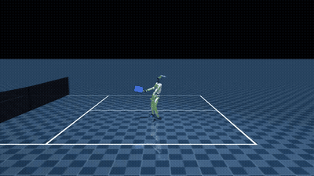
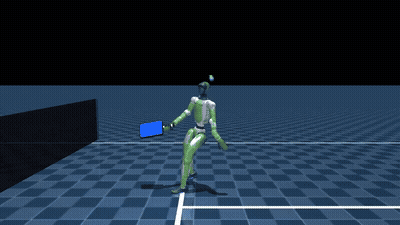
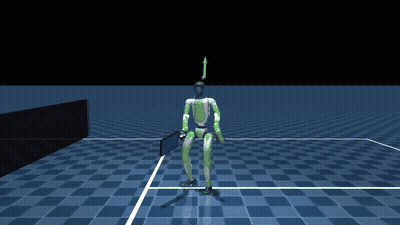
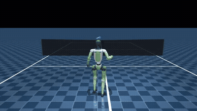

# Picklebot

**Teaching a simulated humanoid to move around the court and play pickleball.**

Unitree G1 (29 DoF, paddle on the right wrist) · mjlab / MuJoCo Warp on the GPU · PPO · human motion prior from tennis mocap and LAFAN1

| Rally across the court | Court-wide drill |
|:---:|:---:|
|  |  |
| **Kitchen-line play** | **Move to any spot** |
|  |  |

Executor `s5c-22-res-rally/model_900`, deterministic, no hints, dev seed 4200910. [Stage 5C report](mjlab/results/stage5c-gate.md)

## Where it stands (Stage 5C, 2026-10-16)

| Working | Still learning |
|---|---|
| **Court-wide returns:** 78.8 % legal over 20 feed families x 3 court zones; 41 of 55 cells >= 75 % | **Volleys:** 0 %; lobs 37-51 %; deep reaches from mid and front court 15-27 % |
| **Footwork:** walks to spots 0.5-3 m away in every direction, 99.4-99.95 % arrival | **Recovery:** about 1.3 m from the recovery spot after a hit (gate 0.5 m) |
| **Movement style:** human-like, from a motion prior learned on tennis mocap and LAFAN1 | **Falls** 3.3 % on court; style score 4.0 (gate 3.86) |
| **Rally test:** 61.8 % of shots aimed at fixed court spots returned; 1.6 % of rallies reach 10 shots | **Sustained rallies:** the robot hits balls aimed at it, but often doesn't reach balls placed elsewhere |

Final numbers are pooled over four fresh development seeds and paired against the stage's starting executor (51.9 %, 14/55 cells). The Stage 5C gate was **not met** (1 of 7 items). The report gives the distance on every criterion and every rule deviation.

## From Unity to mjlab

The project started in Unity with ML-Agents. Its last checkpoint (24M steps) and the docs are kept as a reference ([Unity README](docs/archive/README-unity-2026-10-17.md)). In October 2026 the training moved to mjlab (MuJoCo Warp + rsl_rl) with a Unitree G1 ([plan and log](docs/MJLAB_PIVOT.md)).

| | Unity (to 2026-09) | mjlab (from 2026-10) |
|---|---|---|
| **Body** | Simplified player: bounded shoulder, elbow, wrist and body channels (18) | Unitree G1 humanoid, 29 joints, rigid paddle on the right wrist |
| **Physics** | Unity CPU physics | MuJoCo Warp on the GPU; analytic GPU ball model (drag, spin, bounce, net, paddle) |
| **Throughput** | About 1k env steps/s (8 workers x 16 courts) | 40-55k env steps/s at 12,288 parallel envs on one RTX 4070 |
| **Learning** | ML-Agents PPO, goal-conditioned executor | rsl_rl PPO, plus distillation (DAgger), kickstarting, residual policies, learning-progress curriculum |
| **Motion** | Learned directly in the control channels | Human motion prior: tracking teacher, then a latent controller, then an executor steering its latent |
| **Footwork** | Central returns; wide, deep and short movement still learning | Walks to any spot 0.5-3 m away (99 %+ in every direction) |
| **Shots** | Fixed-ball serve, returns after a bounce, airborne returns | 20 feed families (incl. topspin, backspin, drops, lobs, cross-court) from anywhere on the half court; no serves or volleys yet |
| **Rules** | Two-bounce and kitchen rules in the match engine | The same rules on the GPU (two-bounce, kitchen and momentum faults, out, net) |
| **Best tests** | 224/224 narrow, 260/384 wide, 352/448 randomized returns; 64/64 serves | 78.8 % legal over 55 zone x family cells; 99 %+ move-to-spot arrival; 1.6 % of rallies reach 10 shots |

The two sets of numbers come from different tasks, bodies and test batteries, so they are not directly comparable.

## How the G1 learns

1. **Stage 0-4 — ball, court and hitting:** physics trials, then a standing G1 that returns fed balls and aims them.
2. **Stage 5 — footwork drills:** a flat walking teacher and a flat hitting teacher, distilled into one student.
3. **Stage 5B — human motion prior:** a tracking teacher on retargeted tennis mocap and LAFAN1 locomotion, distilled into a latent motion controller. A PPO executor steers its latent space (gate met: 93.9 % legal on the Stage 5B drill, style 3.81).
4. **Stage 5C — full court:** court zones, volleys and kitchen rules, a move-to-spot drill and a rally test.
   - Footwork in the latent space came from **kickstarting** the flat walking teacher.
   - PPO then improves as a **residual** around a frozen two-skill executor, which keeps both skills.

[Roadmap and log](docs/MJLAB_PIVOT.md) · [Decision log](docs/DECISIONS.md) (D-038 onward for mjlab) · [Stage 5C runs](mjlab/results/stage5c.md)

## Try it

Linux or WSL2 with a CUDA GPU. To set up the environment, run `mjlab/env/setup_wsl.sh`, which pins mjlab 1.6.0; the full freeze is in `mjlab/env/requirements-freeze.txt`. Tasks are registered as `Picklebot-*` (`mjlab/picklebot_mj/tasks/`). Training and evaluation scripts are in `mjlab/scripts/` (e.g. `train_run.sh`, `h5c_eval.sh`, `h5c_videos.sh`). Checkpoints and motion data are not in the repository.

## Next

1. **Rally training:** court-anchored feeds from a scripted opponent, scored by P(rally >= 10), with style and falls brought under their gates.
2. **Volleys and net play:** likely a goal-conditioned motion controller that takes hand and root targets.
3. **Later:** robustness and distillation (Stage 6), two-robot rallies, a learned strategy and doubles (Stage 7+).

This is a learning prototype in simulation; nothing here has run on a real robot.

[Unity README](docs/archive/README-unity-2026-10-17.md) · [Older technical archive](docs/archive/README-before-2026-09-11.md) · [Architecture history](docs/ARCHITECTURE.md)
