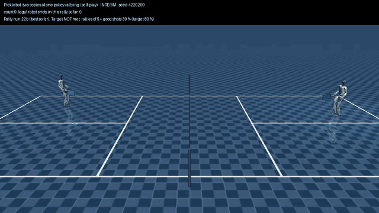
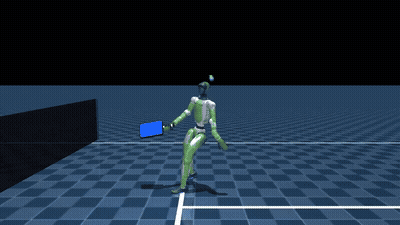
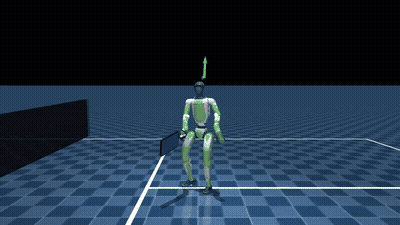
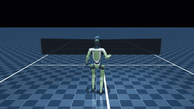
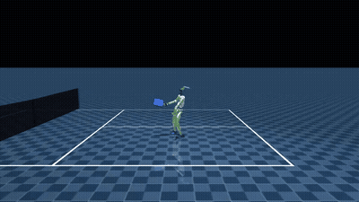

# Picklebot

**Humanoid robots that teach themselves to play pickleball, in a physics simulation.**



*Two copies of the same robot rally across the net. This is the longest rally of four courts: 38 good shots in a row. It is the best of four courts, so it shows the robots at their best.*
[Full rally (MP4)](docs/media/g1-rally-run22b-longest.mp4) · [One court, every rally in order, misses included (MP4)](docs/media/g1-rally-run22b-first.mp4)

| Returns balls from anywhere on its side | Plays at the net |
|:---:|:---:|
|  |  |
| **Steps to a spot in any direction** | **Rallies against a ball machine** |
|  |  |

## What is this?

Pickleball is a paddle sport, a bit like tennis on a small court.

The player here is a **Unitree G1**, a humanoid robot with 29 joints. A paddle is fixed to its right hand. Everything happens in a computer simulation: the robot, the ball, its spin, the bounce and the net all follow physics. No real robot is involved.

**Nobody programs the movements.** Not the swing, the steps, or the balance. The robot learns all of them by practice.

## How it learns

1. **Practice with points.** The robot tries something. It gets points for good results, like a ball that lands in. It loses points for bad ones, like falling over. Over millions of tries, it keeps what earns points. This is called *reinforcement learning*.

2. **Thousands of courts at once.** One graphics card runs about 12,000 courts side by side. A few hours of computer time give the robot years of practice.

3. **Learning from people.** We recorded people playing tennis, walking and running (*motion capture*). The robot first learns to copy those movements. Then it builds every swing and step out of them. That is why it moves like a person and not like a machine.

4. **Teachers and students.** A specialist robot learns one skill, for example walking. Then the main robot learns by copying the specialist. One robot can collect many skills this way.

5. **Keep what works, add on top.** When a skill is good, it is frozen. A small extra controller learns corrections on top of it, so new practice does not erase old skills.

6. **Practice against itself.** In the rally video, both robots are copies of the same program. Each robot gets points when its partner can return its shot, so they learn to keep the rally going.

## Layers of the robot's "brain"

```
 ball, court, partner  -->  rally player  --(what to do next)-->  movement controller  -->  29 joint motors
                            (learned by        small corrections      (learned from human
                             self-play)        on a frozen skill)      motion recordings)
```

- **Movement controller.** It knows how to move like a person: walk, step, swing. It was learned from motion capture.
- **Rally player.** It decides which movement to make, and when, from where the ball is going.

## Where it is going

- **Footwork.** In good pickleball, much of the game is where you stand. The next goal is faster and smarter footwork: side shuffles, quick steps back, and returning to the ready spot after each shot.
- **Competitive play:** robots that play to win, against older versions of themselves.
- **Later:** doubles (2 against 2), and robots that choose their own strategy.

## Words used here

| Word | Meaning |
|---|---|
| Simulation | A computer model of the robot, ball and court that follows physics. |
| Reinforcement learning | Learning by trial and points. |
| Motion capture | Recordings of real human movement. |
| Policy / controller | The program that moves the robot's joints many times every second. |
| Rally | Shots back and forth without a miss. |
| Kitchen | The zone next to the net. You may not volley from there. |

## For robot-learning readers

- **Stack:**
  - [mjlab](https://github.com/mujocolab/mjlab) (MuJoCo Warp) with rsl_rl PPO, on one RTX 4070;
  - a GPU ball model for drag, spin, bounce, net and paddle contact.
- **Motion prior:**
  - a tracking teacher on retargeted tennis mocap and LAFAN1;
  - a PULSE-style latent motion controller (32-d) distilled from it with DAgger.
- **Rally policy:**
  - residual PPO in the latent space around a frozen executor;
  - trained in self-play with a cooperative partner-return reward and a ball-machine feeder.
- **Video above:**
  - rally run 22b, checkpoint 30200;
  - deterministic actions, development seed 4220200;
  - contact hand-off between the robots.
- **Code:**
  - tasks are registered as `Picklebot-*` in `mjlab/picklebot_mj/tasks/`;
  - scripts are in `mjlab/scripts/`;
  - setup is in `mjlab/env/setup_wsl.sh` (Linux or WSL2 with a CUDA GPU).
- **Not in the repository:** checkpoints and motion data (licences).
- **Design notes:** [decision log](docs/DECISIONS.md), [mjlab roadmap](docs/MJLAB_PIVOT.md).
- **Earlier versions of this page:** [October 2026](docs/archive/README-2026-10-30.md), [Unity version](docs/archive/README-unity-2026-10-17.md).

This is a research prototype in simulation. Nothing here has run on a real robot.
