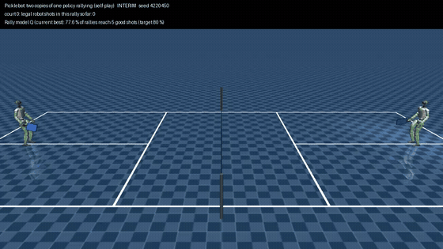
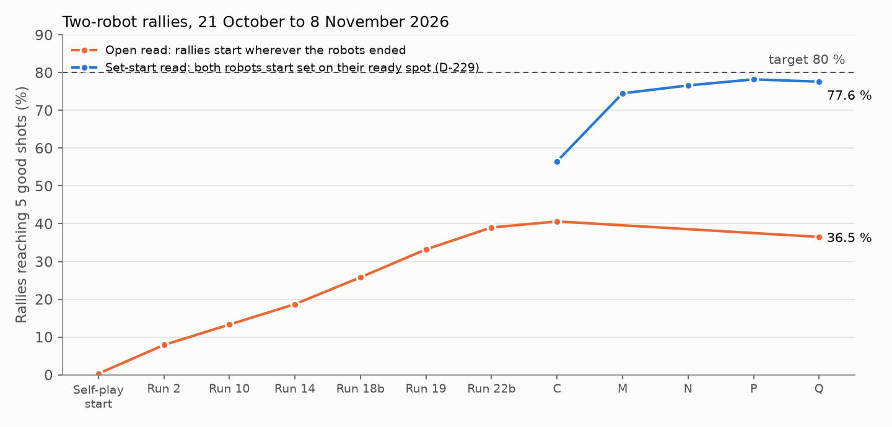
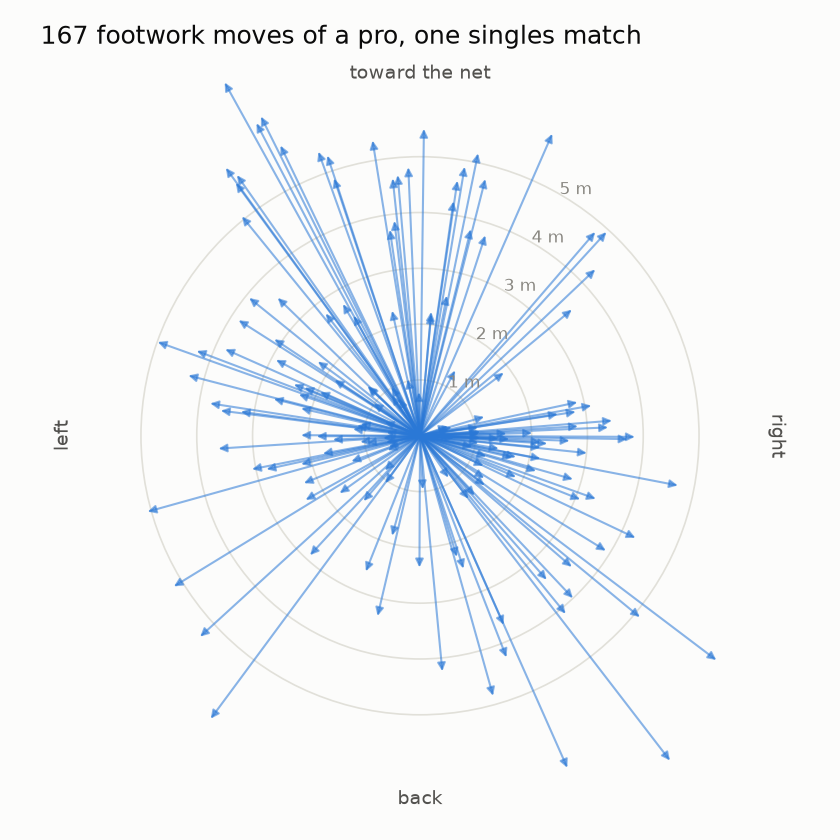
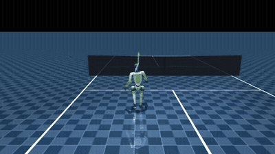
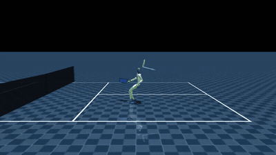

# Picklebot

**Humanoid robots that teach themselves to play pickleball, in a physics simulation.**



*Two copies of the current best robot (model Q) rally across the net, starting set on their ready spots like a drill. The court was chosen before filming, not picked afterwards. It happened to play a single rally for the whole 90-second clip: 68 good shots and no miss. That is better than usual: about 1 rally in 5 still ends before 5 good shots.*
[The full 90 seconds (MP4)](docs/media/g1-rally-q-first.mp4)

## Where it stands (9 November 2026)

| | Now | Goal |
|---|---|---|
| **Rallies that reach 5 good shots in a row**, robot to robot, rallies starting set | **77.6 %** (confirmed on two separate sets of test courts) | 80 % |
| The same, rallies starting wherever the robots ended | 36.5 % | not a goal yet |
| Feeder ball returned (the first shot of a rally) | 88 % | |
| Falls in a 24-second court episode | about 3 % | at most 4 % |
| **First step**: time to cover the first 1.5 m | 1.36 s | the next goal (below) |
| Top speed, held for one second | 1.7 m/s (peaks about 2 m/s) | |



*Each point is one training run, measured on fresh test courts the run never trained on. In early November we started measuring rallies the way a drill starts them: both robots set on their ready spot (blue). The older measure (orange), where a rally starts wherever the last one ended, has stayed near 40 %. Early points used slightly different counting rules.*

## What changed since the last update (30 October)

- **A faster body.** The robot's movement skill was retrained from a footwork specialist, so it now reaches about 2 m/s and keeps that speed through rally practice.
- **Rallies start like a drill.** Rallies are now measured from the proper spot, like a drill. The robots now start set on their ready spot, and we practise that way on half the courts.
- **Better drill-court practice.** Several changes to how the drill courts practise took the score from 56.5 % (model C) to **77.6 % (model Q)**. The last one stops practice rallies after 8 shots on the set-start courts, so more practice goes to the first shots, where most rallies were lost.
- **A review panel.** Every training run is planned by five independent reviewers (learning methods, movement, coaching, experiment design, code). The pass/fail lines are written down before a run starts. Test courts are never reused to pick a winner, and a final set of test courts is kept unopened for the one real exam.
- **What did not work** (each is in the [decision log](docs/DECISIONS.md)):
  - Stopping practice rallies at 5 shots: more rallies passed 5 shots, but long rallies failed more often.
  - Extra practice balls on the three hardest shot types: the first shot improved, but the second shot got worse.
  - A drill built from a pro player's footwork (next section): no change.

## Learning from real pickleball video



We hand-marked 63 rallies of a pro singles match in a small clip editor built for this. From those clips:

1. We tracked the near player's whole body in 3-D (GVHMR).
2. We found the player's feet on the court by lining up the court lines in the image, to within about 3 pixels.
3. We cut the foot track into **167 single moves**: where the player went, how far, and how fast. Pros mostly shuffle side to side, and the longest runs are toward the net. Their average move speed was only 1.0-1.2 m/s, because most rallies never made them sprint.

We then trained the robot on a move drill whose spots came from these moves. It changed nothing: not its first step, its speed, or its rallies. The drill copied *where* the pro moved, but not *how fast*. It had no time pressure, and the small drill area cut many long moves short. The lesson: to get agility, the drill has to demand it.

## Footwork today

| Moving in all directions | Backing up |
|:---:|:---:|
|  |  |

*The current best robot on the move drill, with no ball, in real time. Left: camera behind and following the robot. Right: from the side, moving backward.*

The robot gets everywhere it is sent (99 % of spots) without falling, at a steady 1.6-1.9 m/s. Its weak point is **explosiveness**: it needs about 1.34 s to cover the first 1.5 m in every direction. Every robot we have trained since late October has been stuck at that number. Deadlines, a reward for a fast first step and twice the leg strength each moved it by less than 0.1 s.

What we are checking now:
- **Joint "brakes".** Each joint motor is driven by a controller that slows fast movement. It is set twice as strong as needed to stop a joint overshooting, the default for this robot in the simulator. A test with that brake halved is running.
- **Always facing the net.** The robot is trained to keep its chest to the net, so it shuffles and backpedals instead of turning to run.
- **The frozen movement skill.** The rally layer only adds small corrections to a movement skill learned earlier. If that skill starts slowly, the rally layer cannot fix it.

## What's next: athletic footwork

The next goal is footwork measured like a coach's drill, which we call **call-and-set**.

- **The drill.** A coach calls a ball: "forehand, wide right, now". The robot must start at once, sprint, and be set (a split step) in a balanced ready position on the called side, with the ball within paddle reach, before the ball arrives.
- **The pressure.** Calls come one after another. Some come before the robot has recovered, so it must stop and change direction.
- **The pace.** That of an athletic human, scaled to the robot's size: about 1.3 s for a ball 2 m away, 1.7 s for 3 m.
- **The goal.** 80 % of calls made, the same shape as the rally target. Today's robot, which needs 1.36 s just for its first 1.5 m, will start near zero.
- **First measurement (9 November).** The test is built: `mjlab/picklebot_mj/tasks/call_set.py`. Today's robot makes 0 % of about 52,000 calls. When the ball arrives it is still 1.2 m from its spot on average and carrying its paddle low (0.64 m). The first training run, practising this drill, is under way.
- **The ceiling.** Joint brakes, turning freedom, leg range, a retrained movement skill and agile human motion will each be tried one at a time. The aim is to show either that the robot reaches the goal, or that nothing more can be unlocked in its body.

## What is this?

Pickleball is a paddle sport, a bit like tennis on a small court.

The player here is a **Unitree G1**, a humanoid robot with 29 joints. A paddle is fixed to its right hand. Everything happens in a computer simulation: the robot, the ball, its spin, the bounce and the net all follow physics. No real robot is involved.

**Nobody programs the movements.** Not the swing, the steps, or the balance. The robot learns all of them by practice.

| Returns balls from anywhere on its side | Plays at the net |
|:---:|:---:|
|  |  |

## How it learns

1. **Practice with points.** The robot tries something. It gets points for good results, like a ball that lands in. It loses points for bad ones, like falling over. Over millions of tries, it keeps what earns points. This is called *reinforcement learning*.
2. **Thousands of courts at once.** One graphics card runs about 12,000 courts side by side. A few hours of computer time give the robot years of practice.
3. **Learning from people.** We recorded people playing tennis, walking and running (*motion capture*). The robot first learns to copy those movements. Then it builds every swing and step out of them. That is why it moves like a person and not like a machine.
4. **Teachers and students.** A specialist robot learns one skill, for example footwork. Then the main robot learns by copying the specialist.
5. **Keep what works, add on top.** When a skill is good, it is frozen. A small extra controller learns corrections on top of it, so new practice does not erase old skills.
6. **Practice against itself.** In the rally video, both robots are copies of the same program. Each robot gets points when its partner can return its shot, so they learn to keep the rally going.

```
 ball, court, partner  -->  rally player  --(what to do next)-->  movement skill  -->  29 joint motors
                            (learned by        small corrections    (learned from human
                             self-play)        on a frozen skill)    motion and a footwork specialist)
```

## Words used here

| Word | Meaning |
|---|---|
| Simulation | A computer model of the robot, ball and court that follows physics. |
| Reinforcement learning | Learning by trial and points. |
| Motion capture | Recordings of real human movement. |
| Policy / controller | The program that moves the robot's joints many times every second. |
| Rally | Shots back and forth without a miss. |
| Kitchen | The zone next to the net. You may not volley from there. |
| Split step | A small hop or set as the opponent hits, so a player can push off in any direction. |
| Test courts (seeds) | Fixed random settings used only for measuring, never for training. |

## For robot-learning readers

- **Stack:** [mjlab](https://github.com/mujocolab/mjlab) (MuJoCo Warp) with rsl_rl PPO on one RTX 4070; a GPU ball model for drag, spin, bounce, net and paddle contact.
- **Motion prior:** a tracking teacher on retargeted tennis mocap and LAFAN1. A PULSE-style 32-d latent motion controller is distilled from it with DAgger. The current base (`s5c-d1-fw1bS model_32854`) is that controller kickstarted from a court-scale footwork specialist (D-192 to D-197).
- **Rally policy:**
  - residual PPO in the latent space around the frozen base, with the residual scaled x2 (lam_r 2);
  - trained in pair self-play with a cooperative partner-return reward and a feeder;
  - the set start on half the live pair courts, with practice rallies capped at 8 shots there (D-241 to D-243).
- **The target and its reads:**
  - frozen in [rally-target.md](mjlab/results/rally-target.md); the set-start read was frozen by D-229;
  - the gates are coded in `mjlab/picklebot_mj/d1_rule.py`, every seed is recorded in `mjlab/results/seed-ledger.json`, and the panel rounds are in `mjlab/results/footwork-review.md`;
  - model Q is `rally-d1s3cap8hr2 model_36793`, CONFIRMED in D-243: P(5+) 0.776 on two disjoint seed sets.
- **Pro video pipeline:**
  - user-marked clips, near-player tracking, GVHMR, and a 6-point court homography (1-3 px reprojection);
  - single moves cut from the 0.5-s-smoothed foot track; the frozen table is `mjlab/picklebot_mj/pro_moves_v1.json`;
  - the drill built on it is `mjlab/picklebot_mj/tasks/pro_move.py` (D-249: no effect, see `mjlab/results/agility249-summary.txt`).
- **Videos above:** model Q, deterministic actions, development seeds 4220448 (footwork) and 4220450 (rally), contact hand-off.
- **Code:**
  - tasks are registered as `Picklebot-*` in `mjlab/picklebot_mj/tasks/`;
  - scripts are in `mjlab/scripts/`;
  - setup is in `mjlab/env/setup_wsl.sh` (Linux or WSL2 with a CUDA GPU).
- **Not in the repository:** checkpoints, motion data and match video (licences).
- **Design notes:** [decision log](docs/DECISIONS.md), [review panel](docs/PANEL.md), [mjlab roadmap](docs/MJLAB_PIVOT.md).
- **Earlier versions of this page:** [30 October 2026, run 22b](docs/archive/README-2026-10-30-run22b.md), [October 2026](docs/archive/README-2026-10-30.md), [Unity version](docs/archive/README-unity-2026-10-17.md).

This is a research prototype in simulation. Nothing here has run on a real robot.
